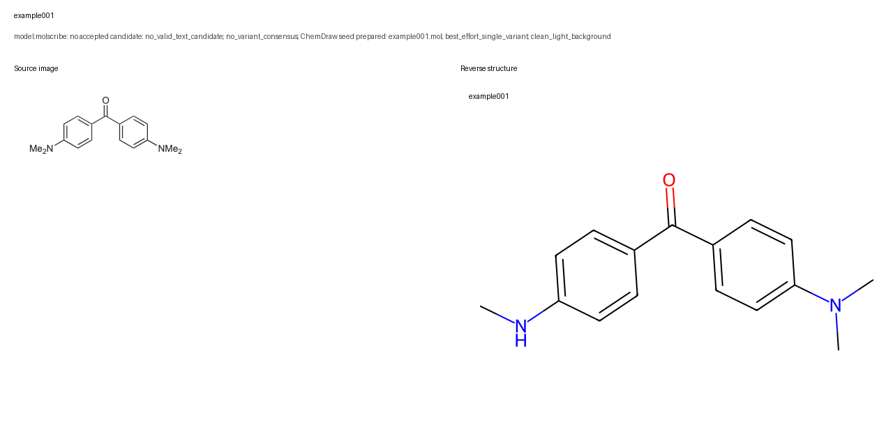
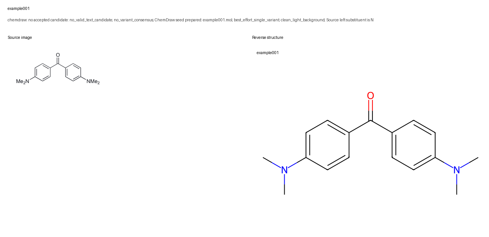

[← Project home](../../README.md) · [Install](../../INSTALL.md) · [Evidence provenance](evidence/PROVENANCE.md)

# example001 · from a figure to Barkla files

Follow **Michler's ketone** through the toolkit. You can also start directly at any step
whose inputs you already have. The taskname and molecule ID in this case are both
`example001`; real tasks may contain many IDs under one taskname.

| Step | Main deliverable |
| --- | --- |
| 1. Prepare an image | [example001.png](output/example001.png) |
| 2. Review the structure | [SMILES report](output/example001_smiles_report.xlsx) and [MOL](output/example001.mol) |
| 3. Complete the master | [Stage snapshots](output/master-stages/) |
| 4. Establish solvents | [Existing six-image audit](../../skills/modules/literature-solvent-extraction/examples/example001/README.md) |
| 5. Export selected IDs | [Three-column SMI](output/barkla/20000101_example001.smi) |
| 6. Extract on Barkla | [Historical verified G298.tsv](output/barkla/G298.tsv) |

## 1. Prepare the image

**Input:** [the five-molecule figure](input/example.png). Only the first molecule is in
this combined example. The full [image-preparation example](../../skills/modules/molecule-image-prep/examples/example/README.md)
keeps all five targets.

> Crop the first molecule as example001. Use taskname example001 and retain the complete
> structure, including both NMe2 groups. Add white padding.

The actual crop box is `(12, 30, 252, 132)`, with 12 pixels of padding on each side.
The resulting PNG is 264 × 126. Inspect the crop and source map before passing the
independent PNG folder to recognition. Pass taskname explicitly; do not derive
`example001_prepare` from the preparation folder name.

## 2. Recognize and review

> Use image-to-smiles on the prepared single-molecule folder. Keep taskname example001
> and the existing image ID. Compare each proposed structure with its source.

This handoff was actually run with the 264 × 126 PNG. Strict recognition had no variant
consensus. One bounded best-effort recovery misread the left NMe2 group as NHMe. The
candidate was rejected, corrected using the source, compared again and finalized.

| Verified field | Value |
| --- | --- |
| SMILES | `CN(C)c1ccc(C(=O)c2ccc(N(C)C)cc2)cc1` |
| InChIKey | `VVBLNCFGVYUYGU-UHFFFAOYSA-N` |
| Final review | `success / high` |

<details>
<summary><strong>Inspect rejected and accepted comparisons</strong></summary>





The existing `chemdraw` correction label records the CLI correction route; it does
not mean that ChemDraw GUI was used. [Model candidates](evidence/model-prediction.json)
are evidence, not accepted chemical truth.

</details>

## 3. Complete the master

> Create an empty master for taskname example001, then fill SMILES and InChIKey from
> this reviewed report. Use the starting paper's Table 1 to complete missing paper data.

If the user already has a master, start from that untouched input instead of making
another blank table. Match by ID. Existing conflicting structure pairs require a
user decision; paper fields default to blank cells.

The paper values here are reused from the maintained [literature example](../../skills/modules/literature-solvent-extraction/examples/example001/README.md),
starting with [Wu, Kim and Teets, Table 1](https://doi.org/10.1055/a-1390-9065).
They include Ered = −2.20 V and Eox = +0.86 V vs. SCE. Preserve the source's signs,
qualifiers and reference numbers; do not convert them to force a match.

### Table stages

| Snapshot | What is complete |
| --- | --- |
| [example001.xlsx](output/master-stages/example001.xlsx) | Empty agreed header |
| [example001_smiles.xlsx](output/master-stages/example001_smiles.xlsx) | ID, SMILES and InChIKey |
| [example001_paper.xlsx](output/master-stages/example001_paper.xlsx) | Supported paper-data fields |
| [example001_solvent.xlsx](output/master-stages/example001_solvent.xlsx) | AI-assisted solvent; manual cell still blank |
| [Reviewed example001_solvent.xlsx](output/human-reviewed/example001_solvent.xlsx) | Curated manual-review fixture; the filename stays the same |

The two solvent files are stored separately here to show before/after review. In a
live task, the user reviews their solvent-stage file without renaming it. The manual
fixture reflects the existing reviewed Barkla SMI; it is not a new human-review claim.

## 4. Trace the electrochemical solvents

> Use literature-solvent-extraction for the missing AI-assisted solvent.
> Starting paper: https://doi.org/10.1055/a-1390-9065, Table 1.

The existing evidence follows the starting paper through its cited review to the
original electrochemical experiments. Oxidation and reduction both support acetonitrile.
The nearby photophysical dichloromethane label is not substituted as the result.

Read the [six-image source chain and audit workbook](../../skills/modules/literature-solvent-extraction/examples/example001/README.md#read-the-evidence).
A live run delivers a new master copy and its independent solvent audit, leaving the
submitted workbook untouched. The user checks that evidence and records accepted
manual solvent choices; the agent never fills the manual column automatically.

## 5. Export the selected molecule

> The structure and manual solvent for example001 are reviewed. Export only example001
> as an SMI file for Barkla.

The resulting line is:

```text
CN(C)c1ccc(C(=O)c2ccc(N(C)C)cc2)cc1 example001 acetonitrile
```

The helper validates the full selection before writing. This output exactly matches
the existing Barkla example. `20000101` is a fixed public example identifier, not an
execution date. Real files use `YYYYMMDD_taskname.smi`.

## 6. Prepare, submit and extract on Barkla

Download the separate [Barkla tools](../../tools/barkla_redox/README.md). Upload its inner
runtime and place the SMI in `inputs/`. Follow the [existing command transcript](../../tools/barkla_redox/examples/example001/transcript.md).
Preparation and real submission remain separate; confirm the calculation scope before
submitting jobs.

The historical verified example used B3LYP/6-31G(d)/IEFPCM with acetonitrile and three
selected states. Its molecule-level G298 energies are −844.297425, −844.109724 and
−844.359728 Hartree for base, oxidized and reduced states respectively.

The [22-column G298.tsv](output/barkla/G298.tsv) is reused from that log-verified result.
No new HPC jobs were run for this integration. This release stops when Barkla has generated
these per-molecule files; it does not download them or backfill the master.

## Sources and verification

[Provenance and execution limits](evidence/PROVENANCE.md) distinguish new local handoffs
from historical literature and HPC evidence. Molecular figures originate from the
component examples; their original citations and third-party rights remain in force.
See [source-image attribution](../../skills/modules/molecule-image-prep/examples/example/README.md)
and [literature citations](../../skills/modules/literature-solvent-extraction/examples/example001/README.md#sources-and-image-attribution).
