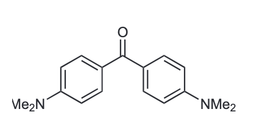
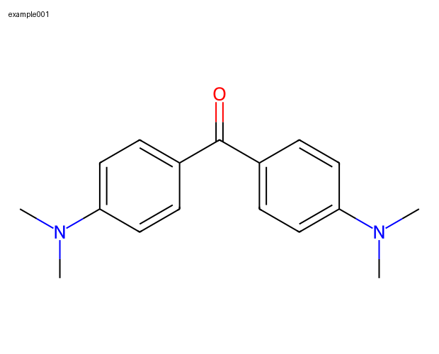
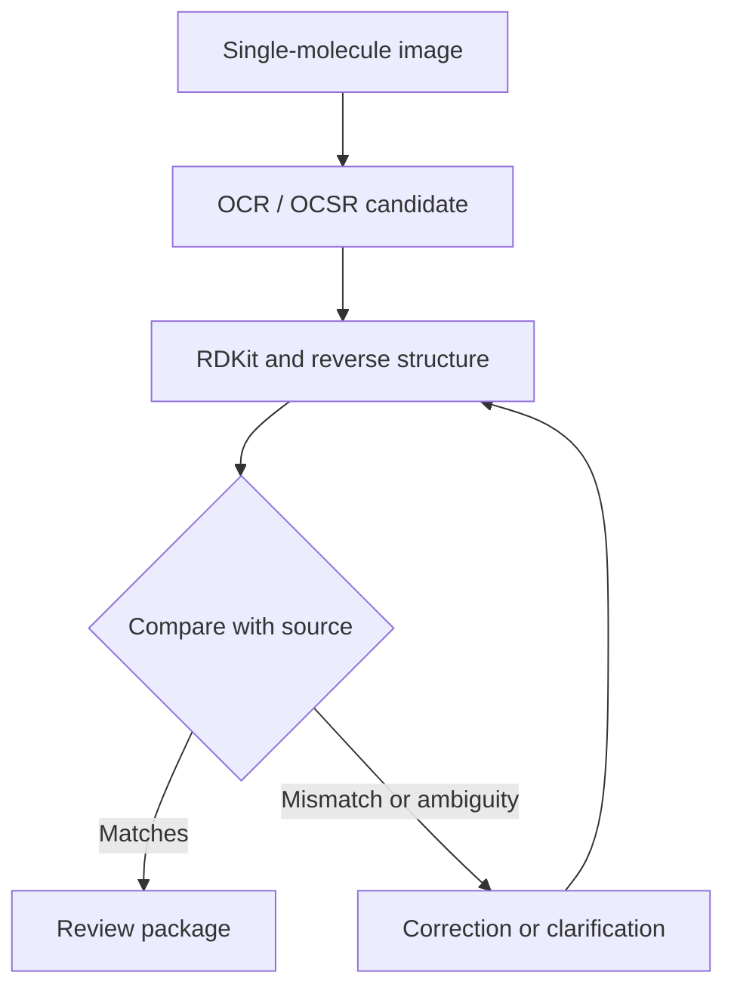

<h1 align="center">image-to-smiles</h1>

<p align="center"><strong>Molecular images → reviewed SMILES, structures, and MOL files.</strong></p>

<p align="center">An agent-guided workflow that keeps recognition evidence, checks every structure against its source,<br>and delivers an inspectable review package.</p>

<p align="center">
  <a href="#quick-start">Quick start</a> ·
  <a href="#worked-example">Worked example</a> ·
  <a href="#what-you-receive">Outputs</a> ·
  <a href="SKILL.md">Agent guide</a>
</p>

## Quick start

Use the [parent toolkit](https://github.com/BanchaoRuan/molecular-research-toolkit) for shared or selective installation. This repository maintains one of its modules; the parent owns download, installation, and version management.

Attach your single-molecule images or provide their folder path, then ask your agent:

```text
Use image-to-smiles with these single-molecule images.
Keep their existing IDs and prepare the reviewed SMILES package.
```

The agent checks its environment, generates candidates, compares the reverse structures with your images, and asks about uncertain structures. A candidate becomes `success` only after source comparison. You do not need a command template or an earlier module if your images are already suitable.

[More prompts](PROMPTS.md) · [Input requirements](#inputs-and-review) · [Commands and environment](references/commands.md)

## Worked example

**`example001` · Michler's ketone**

<table>
  <tr><th width="50%">Input image</th><th width="50%">Reviewed reverse structure</th></tr>
  <tr>
    <td align="center" valign="middle"><a href="examples/example001/input/example001_single_molecule/example001.png"></a></td>
    <td align="center" valign="middle"><a href="examples/example001/output/example001_re_structure/example001.png"></a></td>
  </tr>
</table>

This example tests a useful boundary: **a chemically valid prediction can still misread the image.** A fresh OCR/OCSR run misread both `NMe₂` groups. Source comparison rejected the prediction; a source-guided correction produced the reviewed result shown here. The walkthrough preserves both model attempts and the before/after structures.

[**Follow the example**](examples/example001/README.md) · [**Excel report (.xlsx)**](examples/example001/output/example001_smiles_report.xlsx) · [**MOL structure**](examples/example001/output/example001_chemdraw_input/example001.mol) · [**Readable review**](examples/example001/output/example001_readable.md)

## How it works



Text identifiers are checked through PubChem. Printed structures use MolScribe; suitable photographed inputs use the existing DECIMER hand-drawn route. These routes propose structures. The source comparison decides whether a candidate matches.

Automatic recovery is bounded: a normal first-pass recognition failure gets one retry. Runtime errors stop the task with their cause recorded. No model prediction bypasses source review.

## What you receive

| Deliverable | Purpose |
| --- | --- |
| **SMILES review workbook** | Five columns: `image_id`, `smiles`, `inchikey`, `status`, `confidence`. |
| **Source and reverse images** | Individual structures and overviews for visual inspection. |
| **One MOL per molecule** | A structure readable by RDKit and usable in ChemDraw or another compatible editor. |
| **Readable review and run log** | Decisions, evidence notes, and a task record. |

Full OCR, model, comparison, and event evidence stays in the task project's `workspace/`. Final deliverables go to its `review/`. Runtime materials never go into the module's installation folder. This module does not produce `.smi` files.

<details>
<summary><strong>Review directory layout</strong></summary>

```text
<task-project>/
├── workspace/YYYYMMDD_taskname_smiles/
│   ├── candidates.tsv
│   ├── events.jsonl
│   └── candidate_materials/
└── review/YYYYMMDD_taskname_smiles/
    ├── taskname_smiles_report.xlsx
    ├── taskname_single_molecule_overview.png
    ├── taskname_single_molecule/
    ├── taskname_re_structure_overview.png
    ├── taskname_re_structure/
    ├── taskname_chemdraw/
    ├── taskname_chemdraw_input/
    ├── taskname_readable.md
    └── run_log.md
```

`chemdraw` holds available rejected seeds and may be empty. `chemdraw_input` must contain one validated MOL per image ID. A failed row remains failed even if its seed MOL is readable.

[Complete runtime contract](references/runtime-contract.md)

</details>

## Inputs and review

- Supply **one complete molecule per image** in PNG, JPEG, TIFF, BMP, or WebP format. Split multi-molecule figures first; the parent can route that work to `molecule-image-prep`.
- Image filename stems are molecule IDs. Keep established IDs; ambiguous duplicates are rejected before task creation.
- Preserve atom labels, charges, bond orders, stereochemical marks, salts, and counterions. Multi-fragment inputs need an explicit decision before enabling `--allow-fragments`.
- Confirm ambiguous abbreviations and conflicting candidates. Successful RDKit parsing establishes a usable representation, not agreement with the source.

`pending` means review is incomplete; `success` means the reviewed candidate matches; `failure` means it must not be treated as confirmed. Confidence is a review assessment, not a calibrated model probability.

## For toolkit maintainers

Keep the complete `image-to-smiles/` folder together under the toolkit repository's `skills/modules/`. Make its [SKILL.md](SKILL.md) available for direct requests and workflow routing through the target agent's supported discovery mechanism. Pass the working project and task name explicitly, and preserve IDs across modules. No earlier module is required when suitable images are supplied.

The runtime requires **Python 3.10**, the packages in [requirements.txt](requirements.txt), and **Tesseract**. The complete-batch preflight checks both model stacks. It does not prove that model imports, checkpoints, or services will work. The legacy Conda name `smiles_auto` and script filenames remain stable.

[Integration contract](references/integration.md) · [Command reference](references/commands.md) · [Runtime schema](references/runtime-contract.md) · [Prompts](PROMPTS.md)

Built on [RDKit](https://www.rdkit.org/), [Tesseract](https://github.com/tesseract-ocr/tesseract), [PubChem](https://pubchem.ncbi.nlm.nih.gov/), [MolScribe](https://github.com/thomas0809/MolScribe), and [DECIMER](https://github.com/Kohulan/DECIMER-Image_Transformer). Model packages, weights, and literature figures retain their own licenses and attribution; toolkit licensing is managed at the parent level.

A supplied master remains untouched. The additional `taskname_smiles.xlsx` completes only the involved SMILES/InChIKey pairs; [conflict and ID rules](references/master-handoff.md) apply.
