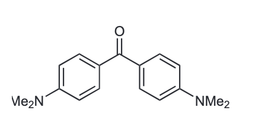
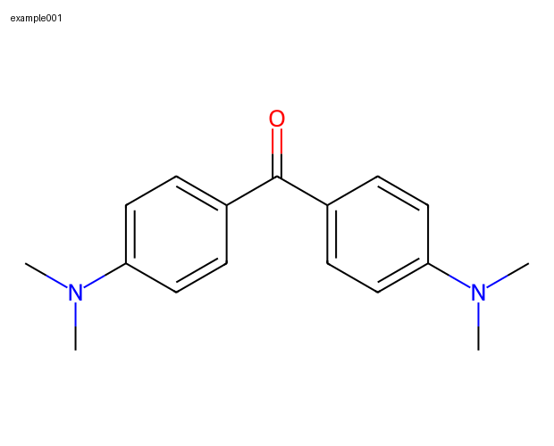
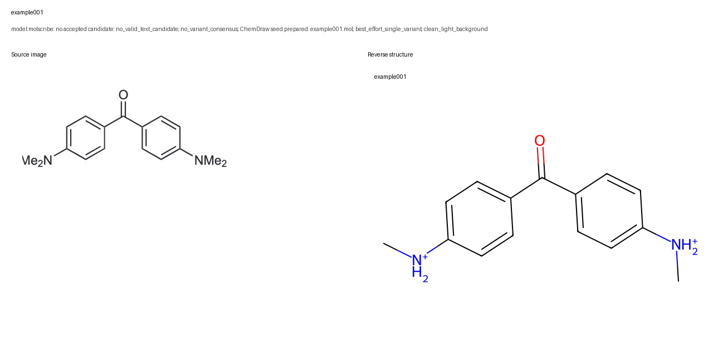

[← Project overview](../../README.md) · [Prompts](../../PROMPTS.md) · [Commands](../../references/commands.md)

# example001 · Michler's ketone

**One image, two recognition attempts, one source-guided correction.** This example follows a fresh OCR and MolScribe run through source comparison, correction, and a completed review package. The accepted structure is 4,4′-bis(dimethylamino)benzophenone, commonly called Michler's ketone.

[Try it](#try-it) · [Recognition evidence](#recognition-evidence) · [Reviewed result](#reviewed-result) · [Reproducibility](#reproducibility)

<table>
  <tr><th width="50%">Source image</th><th width="50%">Accepted structure</th></tr>
  <tr>
    <td align="center" valign="middle"></td>
    <td align="center" valign="middle"></td>
  </tr>
</table>

| File | What to inspect |
| --- | --- |
| [Input PNG](input/example001_single_molecule/example001.png) | The unchanged structure crop used for recognition. |
| [Excel report](output/example001_smiles_report.xlsx) | The five required fields and final review status. |
| [Accepted MOL](output/example001_chemdraw_input/example001.mol) | The corrected molecular structure. |
| [Readable review](output/example001_readable.md) | Recognition, rejection, correction, and source-review notes. |
| [Run summary](output/run_log.md) | A public summary of the completed workflow. |

## Try it

Use the parent toolkit's installation instructions. Copy the [input folder](input/example001_single_molecule/) into your own task project, outside the installed module, and send:

```text
Use image-to-smiles on example001_single_molecule.
Use example001 as the task name and keep example001 as the image ID.
Run recognition, compare the candidate with the image, and prepare the review package.
```

The agent runs the mandatory environment check, reuses an approved model checkpoint or asks before downloading one, and creates a new task workspace. Keep this bundled output unchanged as a reference. An existing same-date `example001` task must be inspected and resumed, not overwritten.

Model output may vary with the software and checkpoint. Review your own result against the source; do not copy the saved `success` flag.

## Recognition evidence

| Stage | Observed result | Evidence |
| --- | --- | --- |
| Tesseract OCR | No valid identifier or text-derived structure; text included `Vie2N ; NMez`. | [OCR JSON](evidence/ocr.json) |
| Strict MolScribe | Raw and enhanced variants contained wildcard atoms. Only the morphology variant passed validation, so there was no two-variant consensus. | [Strict predictions](evidence/molscribe-strict.json) |
| One best-effort recovery | Proposed the morphology variant as a pending candidate. | [Recovery predictions](evidence/molscribe-recovery.json) |
| Source comparison | Rejected both positively charged nitrogen groups; each also lacked one methyl substituent. | [Rejected comparison](evidence/example001_rejected_comparison.png) |
| Correction and review | Restored both neutral `N(CH₃)₂` groups, checked the regenerated image, then finalized. | [Corrected comparison](evidence/example001_corrected_comparison.png) |

The model's RDKit-valid candidate was:

```text
C[NH2+]c1ccc(C(=O)c2ccc([NH2+]C)cc2)cc1
```



The drawing labels both groups `NMe₂`: two methyl groups on each nitrogen, with no positive charge shown. The model instead produced `NH₂⁺(CH₃)` groups. RDKit could parse that different structure, so validity alone could not catch this mismatch.

The agent applied the source-supported correction through `chemdraw_fallback.py apply` and inspected the regenerated comparison. The pipeline records this route as `recognition_method=chemdraw`; the correction was supplied as SMILES through the CLI, without using the ChemDraw GUI. [PubChem CID 7031](https://pubchem.ncbi.nlm.nih.gov/compound/7031) independently supported the corrected identity; it was consulted during verification, not found by OCR. The [lookup record](evidence/pubchem-cid7031.json) preserves its SMILES and InChIKey.

## Reviewed result

```text
CN(C)c1ccc(C(=O)c2ccc(N(C)C)cc2)cc1
```

| Field | Value |
| --- | --- |
| Image ID | `example001` |
| InChIKey | `VVBLNCFGVYUYGU-UHFFFAOYSA-N` |
| Status / confidence | `success` / `high` |
| Source match / RDKit validity | `yes` / `true` |
| Review basis | Benzophenone carbonyl, two para dimethylamino groups, aromatic connectivity, neutral charge, and one fragment. |

Confidence records the source review; it is not a model probability. The accepted MOL was checked against the final SMILES. The [rejected seed MOL](output/example001_chemdraw/example001.mol) is retained for audit and must not be used as the accepted structure.

## Reproducibility

- Tested with Python 3.10.20 on macOS arm64, MolScribe 1.1.1, PyTorch 1.13.1, RDKit 2022.9.5, and SciPy 1.13.1. See the [run manifest](evidence/run-manifest.json) for exact versions, input hash, and checkpoint identity.
- The existing `swin_base_char_aux_1m.pth` checkpoint was reused on CPU. Both recognition attempts processed `raw`, `enhanced`, and `morph` variants. No new model weights were downloaded for this run.
- A native SciPy 1.15.3 loading failure was resolved before inference by replacing it with the verified 1.13.1 build in the same Python environment. Full preflight was repeated, and the initialized task was resumed. That execution error was not counted as a molecular recognition failure.
- This example exercises the printed-image route, real OCR, source review, correction, MOL validation, and report finalization. DECIMER inference and broad platform compatibility were not tested here.

The output workbook preserves the pipeline's five columns and chemical data, with the publication ID set to `example001`. Its document timestamps were removed for publication. The public run log is a relative-path summary; raw dated events and local paths remain in the maintainer's task workspace. Source-image pixels, MOL structures, and recognition predictions are preserved from this run. Publication IDs and generated image labels use `example001`. This is one inspected example, not an accuracy benchmark.

## Source attribution

The input is a supplied structure crop corresponding to Table 1 in Wu, Y.; Kim, D.; Teets, T. S., *Photophysical Properties and Redox Potentials of Photosensitizers for Organic Photoredox Transformations*. [DOI: 10.1055/a-1390-9065](https://doi.org/10.1055/a-1390-9065). The crop was retained without redrawing; reverse structures were generated with RDKit.

Third-party source content retains its original rights. Toolkit licensing does not relicense the literature crop or model weights. Full articles and model weights are not bundled.
