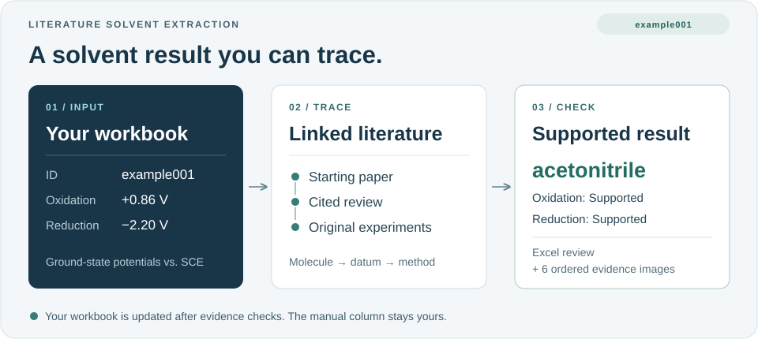
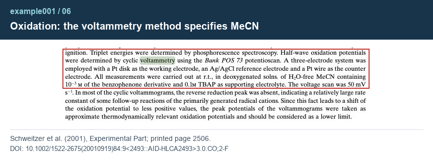

# Literature Solvent Extraction

**Find the solvent behind a reported ground-state redox potential.**

An AI-agent toolkit module for tracing electrochemical solvents. Supply a molecular data workbook and its starting paper; receive supported solvents in your workbook, an Excel review, and source images you can check.

**[Toolkit installation](#1-install-the-skill-bundle)** · [Quick start](#quick-start) · [Worked example](examples/example001/README.md) · [Prompts](PROMPTS.md)



## Quick start

**You need:** Excel or a compatible viewer, plus an AI agent that can edit workbooks, browse papers/PDFs and capture screenshots. A fresh run may need your institutional literature access.

### 1. Install the skill bundle

Use the parent toolkit's main README for its shared download and agent installation instructions. Use the toolkit’s generic directory installer; the module can be called directly and does not require every optional environment.

Once the toolkit is installed, request `literature-solvent-extraction` by name as shown below. You can use this module without running another module first. No personal agent memory is required.

### 2. Attach the example workbook

Save a working copy of [**input/example001.xlsx**](examples/example001/input/example001.xlsx) in your own task project and drag it into the chat. The file is included under this module's `examples/example001/input/` directory in the toolkit.

### 3. Send this message

```text
Use literature-solvent-extraction to fill the missing
electrochemical solvents in the attached workbook.
Starting paper: https://doi.org/10.1055/a-1390-9065 (Table 1).
```

The agent asks for anything missing or ambiguous. It establishes literature access once when needed and reuses authorization within the granted scope. You handle login or MFA; mandatory tool permissions may still appear.

**Using your own data?** Attach your prepared workbook and identify its starting paper(s). The [prompt guide](PROMPTS.md) explains optional row or measurement limits.

## example001 result

**example001 · Michler's ketone**

| Ground-state measurement | Solvent found | Assessment |
| --- | --- | --- |
| Oxidation, +0.86 V vs. SCE | acetonitrile | Supported |
| Reduction, −2.20 V vs. SCE | acetonitrile | Supported |

The AI-assisted cell changes from blank to **`acetonitrile`**. The manual cell stays blank; molecular identifiers and paper data are preserved.

[**Compare the filled workbook**](examples/example001/output/example001.xlsx) · [**Open the Excel review**](examples/example001/output/review/solvent_review.xlsx) · [**Read all six evidence images**](examples/example001/README.md#read-the-evidence)

**Why the evidence matters.** The oxidation article also describes photophysical measurements in dichloromethane. Its electrochemical method specifies **MeCN (acetonitrile)**. The skill checks which experiment the solvent belongs to before writing the result.



*One part of the evidence chain. The [full walkthrough](examples/example001/README.md) connects the molecule, target values, cited sources and methods.*

The packaged input and output are before/after snapshots. For a fresh run, your agent verifies the literature and creates a complete new solvent-stage copy of your workbook.

## What you receive

| Deliverable | How to use it |
| --- | --- |
| **`taskname_solvent.xlsx`** | Inspect supported findings in `Solvent (AI-assisted)`. |
| **`solvent_review.xlsx`** | Check oxidation/reduction assessments; copy source URLs and tested Find terms. |
| **Numbered evidence images** | Read in order to follow the molecule → datum → experiment → solvent chain. |

Excel tables use a plain grid with centered headings and left-aligned text. Column widths and row heights are fitted before delivery so you can read the contents without manually resizing cells.

**Review the images first.** Use the Excel review to return to the papers when needed. After your scientific review, record accepted findings in `Solvent (manual)`.

<details>
<summary><strong>Where the files go</strong></summary>

```text
<your-task-project>/
├── example001.xlsx                # Your input workbook, unchanged
├── workspace/
│   └── YYYYMMDD_example001_solvent/ # Source copies and intermediate work
└── review/
    ├── YYYYMMDD_example001_data/
    │   └── example001_solvent.xlsx
    └── YYYYMMDD_example001_solvent/
        ├── solvent_review.xlsx
        └── evidence/
            ├── example001_01.png
            ├── example001_02.png
            └── ...
```

The input stays at your designated location, unchanged. The new copy contains all original sheets and non-target content. Runtime folders belong to your task project, outside the reusable skill folder. See the [review format](references/review-format.md) for the six audit columns and evidence conventions.

</details>

## Input requirements

| Provide | Required content |
| --- | --- |
| **Molecule identifiers** | Unique, nonblank `ID` and nonblank `SMILES` for each target. |
| **Solvent columns** | Both `Solvent (manual)` and `Solvent (AI-assisted)`; cells may be blank. |
| **Data from Paper** | At least one identifiable ground-state oxidation or reduction potential per target. |
| **Starting paper(s)** | A PDF, DOI or URL, with clear row/measurement mappings when sources differ. |

Use the toolkit master template with its thirteen columns. **InChIKey values and photophysical data may be blank.** A paper alone is not sufficient. See the [complete input specification](references/input-schema.md).

## Scope and boundaries

- **Ground-state electrochemistry only.** Excited-state, spectroscopic, synthesis or reaction solvents cannot substitute for the target measurement's solvent.
- **Trace from your designated papers.** Follow relevant SI and measurement citations. Every supported result needs a complete evidence chain.
- **Write supported results only.** By default, fill AI-assisted cells that were blank at submission. Preserve the manual column and other workbook content.

An incomplete chain is `Unresolved`; a completed search without applicable information is `Not found`. Neither supplies a solvent for backfill. An inaccessible necessary paper pauses the affected work and is reported in chat.

## Explore the module

[Agent instructions](SKILL.md) · [Chat prompts](PROMPTS.md) · [Input specification](references/input-schema.md) · [Review specification](references/review-format.md) · [example001 files](examples/README.md)

Literature excerpts retain their original rights; see [source citations and image attribution](examples/example001/README.md#sources-and-image-attribution).

<details>
<summary><strong>For toolkit maintainers: include this module</strong></summary>

Keep this complete module under `skills/modules/literature-solvent-extraction/` in
[the toolkit](https://github.com/BanchaoRuan/molecular-research-toolkit). Register its
SKILL.md for direct use with the agent's supported discovery mechanism; do not assume
recursive discovery. Module science and examples remain maintained here; the toolkit
provides installation and a selected snapshot. Runtime files belong to the task project.

See [master handoff](references/master-handoff.md) for copy delivery and stage names.
