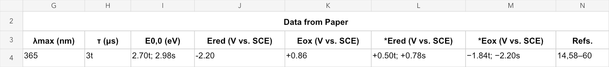
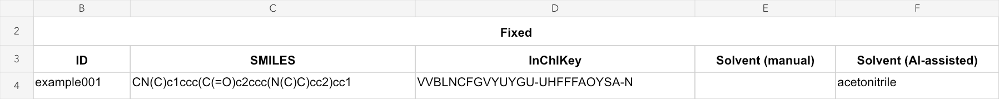
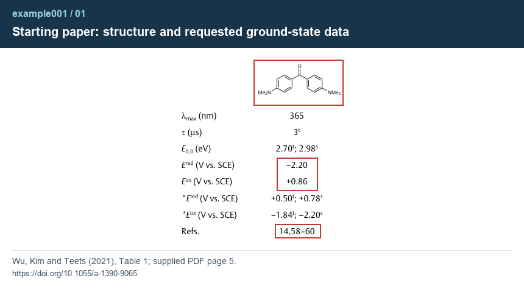
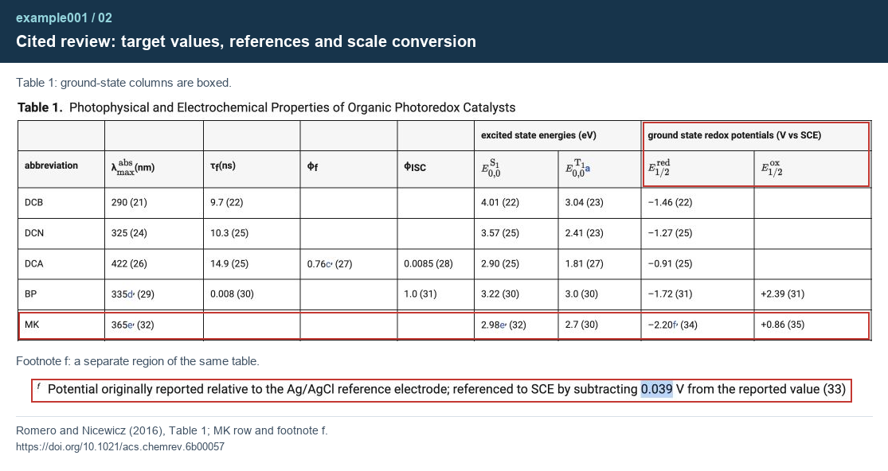
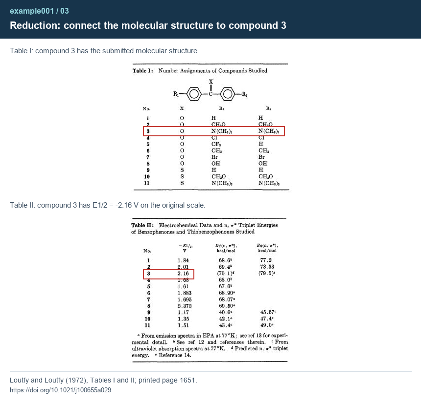
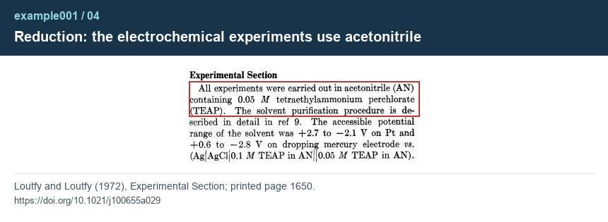
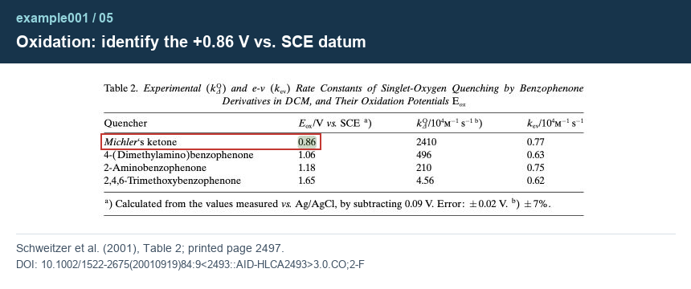
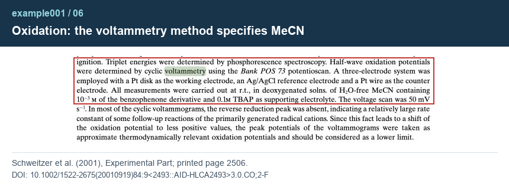

[← Project overview](../../README.md) · [example001 files](../README.md)

# example001 · Michler's ketone

This worked example demonstrates the complete skill: prepare the input, start the agent, check its evidence, and review a supported workbook update.

[Run it yourself](#run-it-yourself) · [example001 result](#example001-result) · [Read the evidence](#read-the-evidence) · [Check the Excel review](#check-the-excel-review)

| File | Purpose |
| --- | --- |
| [input/example001.xlsx](input/example001.xlsx) | Repeatable starting input with both solvent cells blank. |
| [output/example001.xlsx](output/example001.xlsx) | Supported output for comparison. |
| [output/review/solvent_review.xlsx](output/review/solvent_review.xlsx) | Completed six-column Excel audit. |
| [output/review/evidence/](output/review/evidence/) | Six source images in reading order. |

## Run it yourself

1. [Install the skill bundle](../../README.md#1-install-the-skill-bundle) for your agent if it is not already installed. This module is included; no earlier toolkit task is required.
2. Save a working copy of [input/example001.xlsx](input/example001.xlsx) in your own task project and drag it into the chat. Both solvent cells start blank.
3. Send:

   ```text
   Use literature-solvent-extraction to fill the missing
   electrochemical solvents in the attached workbook.
   Starting paper: https://doi.org/10.1055/a-1390-9065 (Table 1).
   ```

You may attach an accessible PDF of that starting paper instead of supplying its DOI. The included output files are available for comparison after your run.

The workbook identifies the single target as `example001`. It contains the SMILES for 4,4′-bis(dimethylamino)benzophenone, commonly called Michler's ketone, and the following paper data:



The targets are **Ered = −2.20 V** and **Eox = +0.86 V vs. SCE**. The starred excited-state values are retained as source data and do not define the requested solvent. The `s` and `t` suffixes distinguish singlet and triplet data.

The agent asks for missing information or initial access permission in chat and reuses existing authorization within its scope. Complete any required library login in its browser session. The original research articles may require institutional access; the included result does not remove that requirement for a fresh verification.

## example001 result

| Measurement | Supported solvent | Assessment |
| --- | --- | --- |
| Oxidation, +0.86 V vs. SCE | acetonitrile | Supported |
| Reduction, −2.20 V vs. SCE | acetonitrile | Supported |

Only `Sheet1!F4`, the AI-assisted solvent cell, changed from blank to `acetonitrile`. The solvent appears once because both assessments support the same solvent. `Solvent (manual)` remains blank. Molecular identifiers and all paper data are preserved.

<details>
<summary><strong>View the saved workbook result</strong></summary>



</details>

A live task creates a complete new solvent-stage copy and leaves the supplied workbook untouched. The separate `input/` and `output/` files here preserve its before/after states for comparison and repeat runs.

## Read the evidence

Open the images in numerical order. Red boxes highlight existing source content. Titles and source labels are added outside the source excerpts. Images 02 and 03 combine separately labelled regions so their connections can be checked together.

**The route:** starting paper → cited review → original reduction and oxidation articles.

| Image | What it establishes |
| --- | --- |
| [01](output/review/evidence/example001_01.png) | The starting paper's molecular structure, ground-state values and references 14, 58–60. |
| [02](output/review/evidence/example001_02.png) | The cited review's MK row assigns reduction to ref. 34 and oxidation to ref. 35. Footnote f documents the reduction reference-scale conversion. |
| [03](output/review/evidence/example001_03.png) | The reduction article identifies the structure as compound 3 and gives 2.16 in its **−E1/2** column. |
| [04](output/review/evidence/example001_04.png) | The reduction article's Experimental Section states that its experiments use acetonitrile. |
| [05](output/review/evidence/example001_05.png) | The oxidation article lists Michler's ketone at +0.86 V vs. SCE. |
| [06](output/review/evidence/example001_06.png) | That article's voltammetry method specifies water-free MeCN, meaning acetonitrile. |



**Why −2.16 and −2.20 are consistent here.** The reduction article uses Ag/AgCl. The cited review explicitly subtracts 0.039 V to report SCE values: −2.16 − 0.039 = −2.199 V, rounding to −2.20 V. This documented provenance connects the target to the original experiment; it is not an undocumented conversion used to force a match. The submitted value was not changed.

<details>
<summary><strong>Continue the reduction chain — images 02–04</strong></summary>







</details>

**Why the nearby DCM label is not the result.** The oxidation article's Table 2 combines photophysical rate constants measured in dichloromethane with oxidation potentials. Its separate electrochemical method specifies MeCN. The method also notes that many voltammograms lack a reverse reduction peak and treats peak potentials as approximate lower limits; the example preserves the paper's reported datum.





## Check the Excel review

Open [solvent_review.xlsx](output/review/solvent_review.xlsx) in Excel. Read the result and status, then scroll right to the source columns. Each logical source entry keeps its role label and full URL together; long URLs wrap visually and remain copyable. Headings are centered, body text is left-aligned, and saved column widths and row heights accommodate the text without manual resizing.

The locators were tested in the actual source readers, not just extracted text:

| Source | Tested Find terms | Observed matches |
| --- | --- | --- |
| Reduction PDF | `2.16`; `Experimental Section` | One each, leading to the datum and method. |
| Cited review, expanded Table 1 | `0.039` | One, leading to footnote f. |
| Oxidation PDF | `0.86`; `voltammetry` | One each, leading to Table 2 and the electrochemical method. |

Use the web page or PDF reader's Find/Search function. Search results can depend on the reader and source version. For example, the oxidation PDF spells the solvent `MeCN`; searching `acetonitrile` there returned no match. That failed synonym search does not make the PDF unsearchable.

The packaged audit records the agent's scientific assessment. After checking the evidence, record your accepted result in the working workbook's manual column.

## Sources and image attribution

The evidence route follows the starting paper, its ref. 14 review, then that review's refs. 34 and 35. These two original articles are also refs. 59 and 60 in the starting paper. Ref. 58 is not needed to establish these electrochemical chains.

- Wu, Y.; Kim, D.; Teets, T. S. *Photophysical Properties and Redox Potentials of Photosensitizers for Organic Photoredox Transformations*. [DOI: 10.1055/a-1390-9065](https://doi.org/10.1055/a-1390-9065). Image 01: early-view PDF, physical page 5, Table 1. Publisher: Thieme.
- Romero, N. A.; Nicewicz, D. A. *Organic Photoredox Catalysis*. [DOI: 10.1021/acs.chemrev.6b00057](https://doi.org/10.1021/acs.chemrev.6b00057). Image 02: publisher HTML Table 1 and footnote f, shown as two explicitly separated regions. Publisher: American Chemical Society.
- Loutfy, R. O.; Loutfy, R. O. *Correlations between the Electrochemical and Spectroscopic Behavior of Some Benzophenones and Thiobenzophenones*. [DOI: 10.1021/j100655a029](https://doi.org/10.1021/j100655a029). Images 03–04: printed pages 1651 and 1650. Publisher: American Chemical Society.
- Schweitzer, C.; Mehrdad, Z.; Noll, A.; Grabner, E.-W.; Schmidt, R. *Oxygen Quenching of nπ\* Triplet Phenyl Ketones: Local Excitation and Local Deactivation*. [DOI: 10.1002/1522-2675(20010919)84:9<2493::AID-HLCA2493>3.0.CO;2-F](https://doi.org/10.1002/1522-2675%2820010919%2984%3A9%3C2493%3A%3AAID-HLCA2493%3E3.0.CO%3B2-F). Images 05–06: printed pages 2497 and 2506. Publisher: Wiley / Helvetica Chimica Acta.

The source excerpts are genuine captures, cropped and marked with thin boxes. Source text, structures and numbers have not been redrawn or replaced. Third-party source content retains its original rights; repository licensing does not relicense these excerpts. Full articles and institutional session links are not bundled.

The packaged filenames are fixed example snapshots. In a new task, the original remains unchanged and the deliverable is `taskname_solvent.xlsx` under the task’s `_data` review directory.
