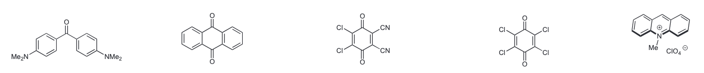
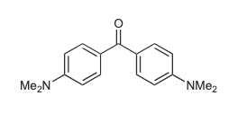
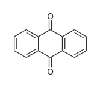
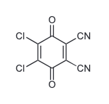
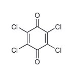
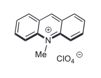

<h1 align="center">molecule-image-prep</h1>

<p align="center"><strong>Molecular figures → checked, traceable image inputs.</strong></p>

<p align="center">Agent-guided cropping into ID-named PNGs, an Excel source map, and a review overview.<br>Complete structures. Stable molecule IDs. Original images preserved.</p>

<p align="center">
  <a href="#quick-start">Quick start</a> ·
  <a href="#worked-example">Worked example</a> ·
  <a href="#outputs">Outputs</a> ·
  <a href="SKILL.md">Agent guide</a>
</p>

## Quick start

Once your parent workflow has installed this subskill, attach your images or provide an image-folder path and ask your agent:

```text
Use molecule-image-prep with these images.
Prepare the single-molecule review package.
```

The agent crops and visually checks the targets, then returns the PNGs and review files. It reuses requirements already established in your conversation or parent workflow and asks only about missing or ambiguous information.

[More prompt examples](PROMPTS.md)

## Worked example

**One source image → five individual PNGs and five source-mapping rows.**

**Input**



**Checked crops** · Open any image to inspect the original PNG.

<table align="center">
  <tr>
    <td width="50%" align="center" valign="top">
      <a href="examples/example/output/example_prepare_single_molecule/example001.png"><strong>example001</strong></a><br>
      <a href="examples/example/output/example_prepare_single_molecule/example001.png"></a>
    </td>
    <td width="50%" align="center" valign="top">
      <a href="examples/example/output/example_prepare_single_molecule/example002.png"><strong>example002</strong></a><br>
      <a href="examples/example/output/example_prepare_single_molecule/example002.png"></a>
    </td>
  </tr>
  <tr>
    <td width="50%" align="center" valign="top">
      <a href="examples/example/output/example_prepare_single_molecule/example003.png"><strong>example003</strong></a><br>
      <a href="examples/example/output/example_prepare_single_molecule/example003.png"></a>
    </td>
    <td width="50%" align="center" valign="top">
      <a href="examples/example/output/example_prepare_single_molecule/example004.png"><strong>example004</strong></a><br>
      <a href="examples/example/output/example_prepare_single_molecule/example004.png"></a>
    </td>
  </tr>
  <tr>
    <td colspan="2" align="center" valign="top">
      <a href="examples/example/output/example_prepare_single_molecule/example005.png"><strong>example005</strong></a><br>
      <a href="examples/example/output/example_prepare_single_molecule/example005.png"></a>
    </td>
  </tr>
</table>

The final crop keeps the charged structure and its perchlorate counterion together. Each output retains its original pixel scale with white padding.

[Example walkthrough](examples/example/README.md) · [Excel report (.xlsx)](examples/example/output/example_images_report.xlsx) · [Full overview](examples/example/output/single_molecule_overview.png)

## Inputs and IDs

Supply single-frame **PNG, JPEG, TIFF, BMP, or WebP** images containing one or more complete targets. For folder input, place the intended images directly in that folder. PDF, HEIC, SVG, and format conversion are outside this release.

All four information groups below are required. Values already supplied are reused; the agent determines crop coordinates and source positions.

| Information | In the worked example |
|---|---|
| Task name | `example` |
| ID prefix, digit count, starting ID | `example`, `3`, `example001` |
| Existing IDs and their molecular correspondence | None; other tasks may retain established IDs |
| Crop and layout requirements | Complete structures, 12 px white padding, no resizing |

**IDs follow molecules.** The same molecule may keep its ID across batches and subskills. An ID must not be reassigned to a different molecule. New numbering skips all known reserved IDs, including those whose crops have not yet been made.

A crop can be corrected under the same ID. The agent checks atom labels, bonds, charges, stereochemical marks, and target coverage, then rebuilds the affected review package. This step prepares image inputs; it does not generate SMILES or reconstruct missing chemical information.

## Outputs

| Deliverable | What it contains |
|---|---|
| **Individual PNGs** | One checked image per molecule ID, ready for downstream processing |
| **Excel source map** | The seven-field correspondence between each output ID and its source |
| **Review overview** | A preview of the batch for convenient inspection |

Task materials belong to the working project's `workspace/` and `review/`. Use the individual PNGs as downstream inputs.

<details>
<summary><strong>Directory layout and mapping fields</strong></summary>

```text
<project_root>/
├── workspace/
│   └── YYYYMMDD_taskname_images/
└── review/
    └── YYYYMMDD_taskname_images/
        ├── taskname_images_report.xlsx
        ├── single_molecule_overview.png
        └── taskname_prepare_single_molecule/
            └── <image_id>.png
```

The mapping fields are `image_id`, `source_image_id`, `source_position_id`, `source_location`, `source_image_path`, `single_molecule_path`, and `notes`. Source references use portable filenames. Keep the source images available for inspection.

</details>

## Parent integration

This repository maintains a complete subskill for a parent workflow to distribute and install. Keep the whole folder together. The parent supplies the working project, the intended task name, and **Python 3.10+**, **Pillow**, and **openpyxl**; pinned dependency versions are in [requirements.txt](requirements.txt).

The instructions use ordinary image viewing, local files, and Python commands. Downstream stages receive the task name explicitly and retain the molecule IDs.

[Agent workflow](SKILL.md) · [Commands and mapping schema](references/commands.md) · [User prompts](PROMPTS.md)
