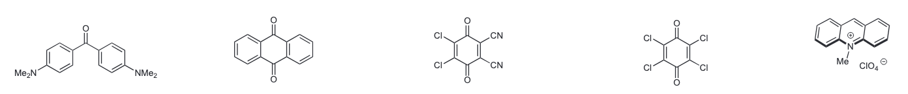
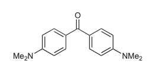
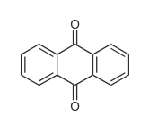
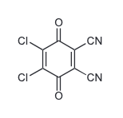
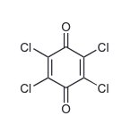
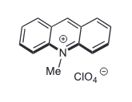

# Example · one image, five targets

[← Back to the skill](../../README.md) · [Excel report (.xlsx)](output/example_images_report.xlsx) · [Full overview](output/single_molecule_overview.png)

The five targets below were cropped from one source image and checked individually. IDs follow their left-to-right order in the source.

## Source



[Open the source PNG](input/example.png)

## Checked outputs

Open a crop to inspect the original PNG. Each image preserves the source pixel scale and adds 12 pixels of white padding on every side.

<table align="center">
  <tr>
    <td width="50%" align="center" valign="top">
      <a href="output/example_prepare_single_molecule/example001.png"><strong>example001</strong></a><br>
      <a href="output/example_prepare_single_molecule/example001.png"></a>
      <br><sub>Both dimethylamino labels retained.</sub>
    </td>
    <td width="50%" align="center" valign="top">
      <a href="output/example_prepare_single_molecule/example002.png"><strong>example002</strong></a><br>
      <a href="output/example_prepare_single_molecule/example002.png"></a>
      <br><sub>Both carbonyl oxygens retained.</sub>
    </td>
  </tr>
  <tr>
    <td width="50%" align="center" valign="top">
      <a href="output/example_prepare_single_molecule/example003.png"><strong>example003</strong></a><br>
      <a href="output/example_prepare_single_molecule/example003.png"></a>
      <br><sub>Chlorine labels and CN groups retained.</sub>
    </td>
    <td width="50%" align="center" valign="top">
      <a href="output/example_prepare_single_molecule/example004.png"><strong>example004</strong></a><br>
      <a href="output/example_prepare_single_molecule/example004.png"></a>
      <br><sub>All four chlorine labels retained.</sub>
    </td>
  </tr>
  <tr>
    <td colspan="2" align="center" valign="top">
      <a href="output/example_prepare_single_molecule/example005.png"><strong>example005</strong></a><br>
      <a href="output/example_prepare_single_molecule/example005.png"></a>
      <br><sub>Cation, perchlorate counterion, and charge marks retained together.</sub>
    </td>
  </tr>
</table>

The fifth target includes its counterion as part of the same output. This example checks crop completeness and source correspondence; it does not assign molecular names or validate SMILES.

The [Excel report](output/example_images_report.xlsx) contains one row per output ID and the standard seven mapping fields. Column widths fit the contents, long notes wrap, and row heights accommodate the wrapped text. Source position IDs `1`–`5` describe the left-to-right order; they are not printed labels in the image. Every row references `example.png`.

## Try this example

Provide the [source PNG](input/example.png) to an agent with the subskill available and use:

```text
Use molecule-image-prep with example.png.
Name the task example.
Use prefix example, three digits, starting at example001.
There are no existing IDs to retain.
Process the five complete targets from left to right.
Preserve the fifth target's counterion and charge marks.
Add 12 pixels of white padding on every side without resizing.
```

The task uses `workspace/YYYYMMDD_example_images/` and `review/YYYYMMDD_example_images/` in the working project. See the [command reference](../../references/commands.md) for execution details.

<details>
<summary><strong>Exact crop settings and output dimensions</strong></summary>

Boxes use source-pixel coordinates in the order left, top, right, bottom. Right and bottom are exclusive. Every command uses `--source-image-id example` and `--padding 12 12 12 12`.

| ID | Position ID | `source_location` | `--box` | PNG size |
|---|---|---|---|---|
| `example001` | `1` | `far-left` | `12 30 252 132` | 264 × 126 |
| `example002` | `2` | `left-center` | `348 16 490 140` | 166 × 148 |
| `example003` | `3` | `center` | `655 16 785 140` | 154 × 148 |
| `example004` | `4` | `right-center` | `976 18 1098 142` | 146 × 148 |
| `example005` | `5` | `far-right` | `1237 18 1378 122` | 165 × 128 |

Omit `--image-id` for these new targets so the initialized numbering scheme assigns the IDs. Inspect each crop before building the review package. The default five-column overview follows the source's left-to-right order.

</details>

<details>
<summary><strong>Included files and source handling</strong></summary>

```text
example/
├── README.md
├── input/
│   └── example.png
└── output/
    ├── example_images_report.xlsx
    ├── single_molecule_overview.png
    └── example_prepare_single_molecule/
        ├── example001.png
        ├── example002.png
        ├── example003.png
        ├── example004.png
        └── example005.png
```

The supplied source image keeps its original decoded pixels with screenshot metadata removed. The workbook preserves the generated mapping values with run-specific document metadata removed. Runtime configuration, absolute source paths, and development logs are excluded.

</details>
