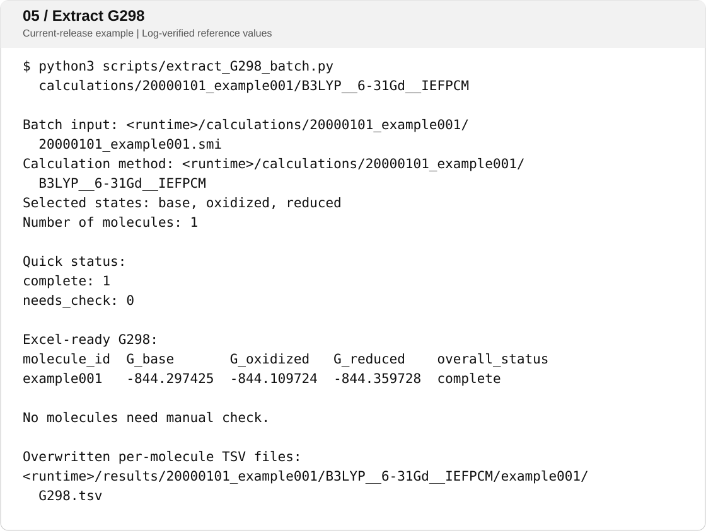
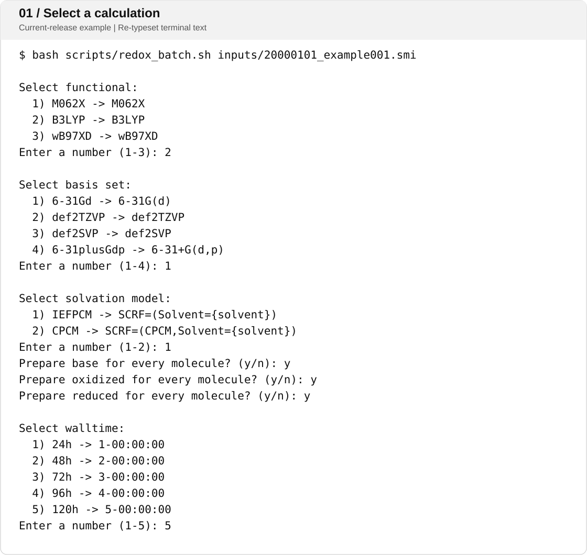
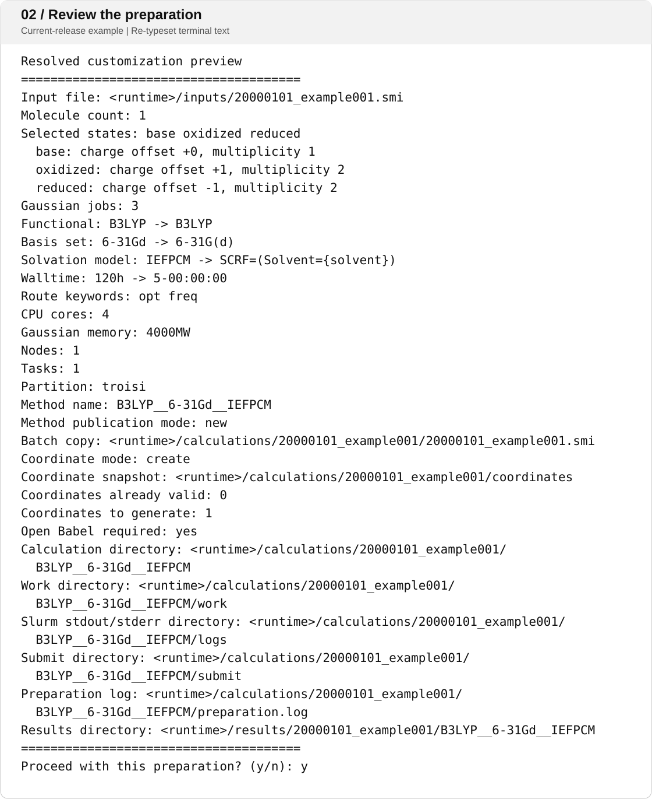
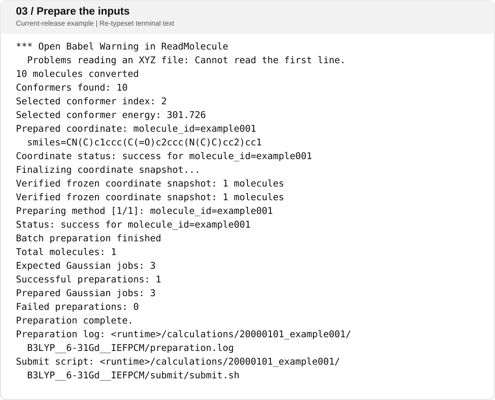
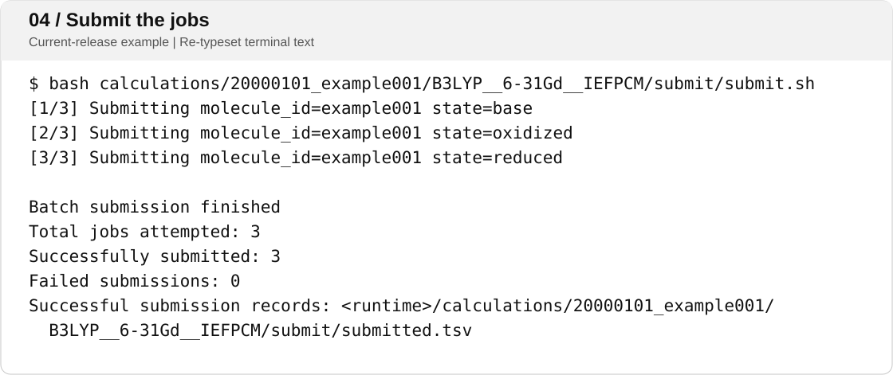

# example001

One molecule, three charge states: prepare Gaussian inputs, submit the jobs, then extract G298.

[Input SMI](20000101_example001.smi) · [Result TSV](output/G298.tsv) · [Copyable terminal transcript](transcript.md) · [Environment](../../ENVIRONMENT.md)

The monochrome figures pair current-release commands and resource previews with results checked against the supplied Gaussian logs; they are re-typeset examples, not captures of a fresh run with those defaults.



## Calculation

| Setting | Value |
| --- | --- |
| Input / molecule ID | `20000101_example001.smi` / `example001` |
| Functional / basis | B3LYP / 6-31G(d) |
| Solvation | IEFPCM / acetonitrile |
| States | base, oxidized, reduced |
| Route keywords | `opt freq` |
| Release resource defaults | 4 CPU cores, `4000MW`, 1 node, 1 task |
| Selected walltime | 120 h (`5-00:00:00`) |
| Method directory | `B3LYP__6-31Gd__IEFPCM` |

`20000101` is a fixed example identifier, not a calculation date. The SMILES and solvent are unchanged; only the public molecule ID is renamed to `example001`.

Resources and menu choices are editable in `redox_customization.json`. Keep every option list nonempty, check charge and spin for your own molecules, and replace the supplied `troisi` partition if you are not authorized to use it. Gaussian memory must fit the actual Slurm allocation.

## Run the example

Upload only `barkla_redox/` under your tools directory. Place [the SMI](20000101_example001.smi) separately in its `inputs/` directory. README files, environment notes and these figures do not need to be uploaded.

Run the following commands **inside that runtime directory**, at its final location. Use a new batch name if `20000101_example001` has already been prepared there; prepared tasks must not be overwritten or relocated.

### 1. Prepare

```bash
bash scripts/redox_batch.sh inputs/20000101_example001.smi
```

With the supplied configuration, choose `2` for B3LYP, `1` for 6-31Gd and `1` for IEFPCM; answer `y` for all three states; choose `5` for 120 h. Confirm the preview only after checking the method, three jobs, 4 cores and `4000MW`. Preparation does not submit any job.

<details>
<summary>Selection menus</summary>



</details>

<details>
<summary>Preparation preview</summary>



</details>

<details>
<summary>Preparation result</summary>



</details>

The preparation excerpt retains the observed Open Babel XYZ-reading warning. It is followed by coordinate-snapshot verification and successful preparation; the Gaussian results below were checked independently. The warning is not silently removed or claimed to be fixed.

Generated COM and Slurm inputs are under:

```text
calculations/20000101_example001/B3LYP__6-31Gd__IEFPCM/work/example001/
```

New result directories do not receive an XYZ copy.

### 2. Submit

Check the generated inputs first. **This command submits three real Gaussian jobs** using the configured partition and selected walltime:

```bash
bash calculations/20000101_example001/B3LYP__6-31Gd__IEFPCM/submit/submit.sh
```

<details>
<summary>Submission result: three submitted, zero failed</summary>



</details>

Successful submission is not proof of completed calculations. Do not also submit the individual Slurm files or bypass submission records after a partial failure.

### 3. Extract

After the jobs finish:

```bash
python3 scripts/extract_G298_batch.py calculations/20000101_example001/B3LYP__6-31Gd__IEFPCM
```

The per-molecule table is written to:

```text
results/20000101_example001/B3LYP__6-31Gd__IEFPCM/example001/G298.tsv
```

Extraction can be repeated, including while calculations are running. Each invocation refreshes this batch's tables; a temporary `no_G298` or `missing_log` is not proof that a running job has failed.

## Verified result

| State | Charge | Multiplicity | G298 / Hartree | Status |
| --- | ---: | ---: | ---: | --- |
| base | 0 | 1 | -844.297425 | complete |
| oxidized | +1 | 2 | -844.109724 | complete |
| reduced | -1 | 2 | -844.359728 | complete |

All three supplied logs contain completed optimization, two normal terminations and at least five finite, strictly positive frequencies. The current extractor's result-reading functions agree with every energy and status in the returned table. The [published TSV](output/G298.tsv) preserves all 22 columns and all original values except `molecule_id`.

This example does not need recovery. For a genuinely finished task without G298, use the optional [independent recovery workflow](../../README.md#independent-recovery); no failed calculation is manufactured for this demonstration.

Only the reviewed SMI, TSV, text and SVG figures are public example assets. Raw logs, checkpoints, scheduler records, personal paths and original terminal screenshots are not included.
